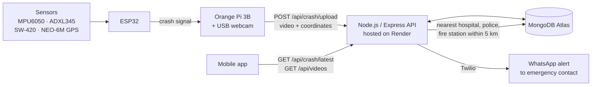

# S.C.A.R — Smart Crash Alert & Response

An IoT system that detects vehicle crashes, records video evidence, finds the nearest emergency facilities, and sends a WhatsApp alert to emergency contacts automatically.

Built as the final project for the Telematics Project course (Proyek Telematika), Department of Computer Engineering, Institut Teknologi Sepuluh Nopember (ITS).

---

## How it works



1. **Detect.** The ESP32 reads the accelerometer, gyroscope and vibration sensors and flags a crash when impact and orientation change pass their thresholds.
2. **Record.** The Orange Pi captures webcam footage from before and after the impact.
3. **Report.** The Orange Pi uploads the video, GPS coordinates and crash type to the backend.
4. **Locate help.** The backend runs MongoDB geospatial (`$near`, `2dsphere`) queries to find the nearest hospital, police station and fire station within 5 km.
5. **Alert.** The backend sends a WhatsApp message through Twilio with a Google Maps link, the time and links to the video.
6. **Monitor.** The mobile app shows the latest crash, the nearby facilities and the recorded footage.

## Tech stack

| Layer | Technology |
|---|---|
| Hardware | ESP32, Orange Pi 3B, MPU6050, ADXL345, SW-420, u-blox NEO-6M GPS, USB webcam |
| Backend | Node.js, Express 5, Multer (video upload), Mongoose |
| Database | MongoDB Atlas with `2dsphere` geospatial indexes |
| Notifications | Twilio WhatsApp API |
| Mobile | Flutter |
| Hosting | Render |
| Testing | Jest, Supertest |

## API reference

| Method | Endpoint | Description |
|---|---|---|
| `GET` | `/` | Health check and list of endpoints |
| `POST` | `/api/crash/upload` | Submit a crash report (multipart: video files, `coordinates`, `jenisKecelakaan`) |
| `GET` | `/api/crash/latest` | Latest crash report with its nearby facilities |
| `GET` | `/api/v1/hospitals` | List hospitals |
| `GET` | `/api/v1/hospitals/nearby?lat=&lng=&maxDistance=` | Hospitals near a point (default 5,000 m) |
| `GET` | `/api/v1/police` · `/api/v1/police/nearby` | Police stations, all or nearby |
| `GET` | `/api/v1/damkar` · `/api/v1/damkar/nearby` | Fire stations, all or nearby |
| `POST` | `/api/upload` | Upload video files only |
| `GET` | `/api/videos` | List uploaded crash videos |
| `GET` | `/uploads/:filename` | Stream a video (supports HTTP range requests) |

**Example crash report**

```bash
curl -X POST http://localhost:3000/api/crash/upload \
  -F "coordinates=[112.7966, -7.2892]" \
  -F "jenisKecelakaan=Tabrakan" \
  -F "file1=@crash.mp4"
```

Coordinates use GeoJSON order: `[longitude, latitude]`. Accepted video formats are `.mp4`, `.mov` and `.avi`, up to 100 MB.

## Project structure

```
smart-crash-alert/
├── Backend/
│   ├── app.js                  # Express app, routes, video streaming
│   ├── db.js                   # MongoDB connection
│   ├── controllers/
│   ├── middleware/upload.js    # Multer config (video only, 100 MB)
│   ├── models/                 # CrashReport, Hospital, PoliceStation, FireStation
│   ├── routes/                 # crash, hospitals, police, firestation
│   ├── Services/
│   │   ├── alertService.js     # Nearest-facility search + crash logging
│   │   └── whatssappService.js # Twilio WhatsApp notification
│   └── tests/
├── Hardware/
│   └── network_manager.ino     # ESP32 Wi-Fi + HTTP client
└── mobile/services/            # Map and distance helpers
```

## Running locally

**Requirements:** Node.js 18+, a MongoDB Atlas cluster (or local MongoDB), and a Twilio account with the WhatsApp sandbox enabled.

```bash
git clone https://github.com/Jtnzzz/smart-crash-alert.git
cd smart-crash-alert/Backend
npm install
cp .env.example .env    # then fill in your own values
node app.js
```

The API starts on `http://localhost:3000`.

**Environment variables** (see `.env.example`):

| Variable | Description |
|---|---|
| `MONGODB_URI` | MongoDB connection string |
| `PORT` | Server port (default `3000`) |
| `TWILIO_ACCOUNT_SID` | Twilio account SID |
| `TWILIO_AUTH_TOKEN` | Twilio auth token |
| `WHATSAPP_RECIPIENT` | Emergency contact number, e.g. `+62812xxxxxxx` |
| `BASE_URL` | Public URL of the backend, used for video links in alerts |

**Hardware:** open `Hardware/network_manager.ino` in Arduino IDE, set your Wi-Fi credentials and backend URL, then flash it to the ESP32.

## Team

| Name | Role |
|---|---|
| Justin Christopher Tetelepta | Backend & API, Twilio integration, [your other parts] |
| Cedric Anthony Edysa | [role] |
| Barra Alastair Prayata | [role] |

Supervised by Ahmad Zaini, S.T., M.T.; Dr. Arief Kurniawan, S.T., M.T.; and Prof. Dr. I Ketut Eddy Purnama, S.T., M.T.

## Future work

- Improve the detection algorithm to reduce false alarms and tell crash types apart
- Add a backup battery and better power management
- Test with simulated crash scenarios together with drivers and emergency responders
